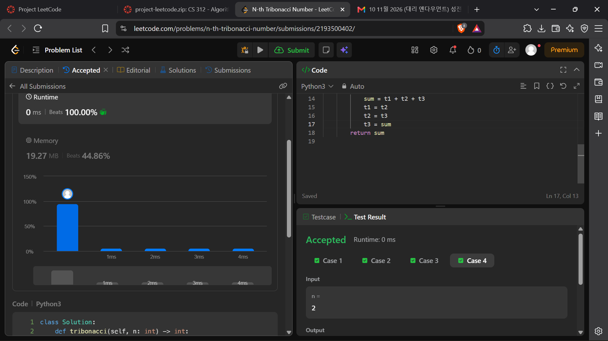

# Project Leetcode

## Problem 1 [25 points]

### Problem Information

Problem Name: *Tribonacci*

[https://leetcode.com/problems/n-th-tribonacci-number/submissions/2193500402/]()

*Insert your screenshot here, named `problem-1.png`.*

### Time Complexity

*Fill me in*

### Space Complexity

*Fill me in*

----

## Problem 2 [25 points]

### Problem Information

Problem Name: *fill me in*

[Submission Link]()

*Insert your screenshot here, named `problem-2.png`.*

### Time Complexity

*Fill me in*

### Space Complexity

*Fill me in*

----

## Problem 3 [25 points]

### Problem Information

Problem Name: *fill me in*

[Submission Link]()

*Insert your screenshot here, named `problem-3.png`.*

### Time Complexity

*Fill me in*

### Space Complexity

*Fill me in*

----

## Problem 4 [10 points]

### Problem Information

Problem Name: *fill me in*

[Submission Link]()

*Insert your screenshot here, named `problem-4.png`.*

### Time Complexity

*Fill me in*

### Space Complexity

*Fill me in*

----

## Problem 5 [10 points]

### Problem Information

Problem Name: *fill me in*

[Submission Link]()

*Insert your screenshot here, named `problem-5.png`.*

### Time Complexity

*Fill me in*

### Space Complexity

*Fill me in*

----

## Problem 6 [5 points]

### Problem Information

Problem Name: *fill me in*

[Submission Link]()

*Insert your screenshot here, named `problem-6.png`.*

### Time Complexity

*Fill me in*

### Space Complexity

*Fill me in*

----

## Problem 7 [5 extra credit points]

### Problem Information

Problem Name: *fill me in*

[Submission Link]()

*Insert your screenshot here, named `problem-7.png`.*

### Time Complexity

*Fill me in*

### Space Complexity

*Fill me in*

----

## Problem 8 [5 extra credit points]

### Problem Information

Problem Name: *fill me in*

[Submission Link]()

*Insert your screenshot here, named `problem-8.png`.*

### Time Complexity

*Fill me in*

### Space Complexity

*Fill me in*

----

## Problem 9 [5 extra credit points]

### Problem Information

Problem Name: *fill me in*

[Submission Link]()

*Insert your screenshot here, named `problem-9.png`.*

### Time Complexity

*Fill me in*

### Space Complexity

*Fill me in*

----

## Problem 10 [5 extra credit points]

### Problem Information

Problem Name: *fill me in*

[Submission Link]()

*Insert your screenshot here, named `problem-10.png`.*

### Time Complexity

*Fill me in*

### Space Complexity

*Fill me in*

## Project Review

*Fill me in*