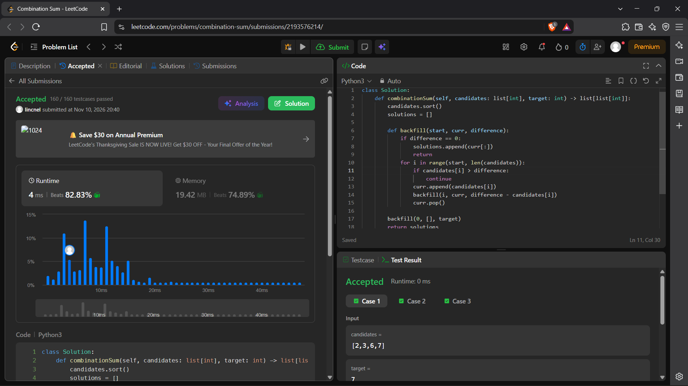
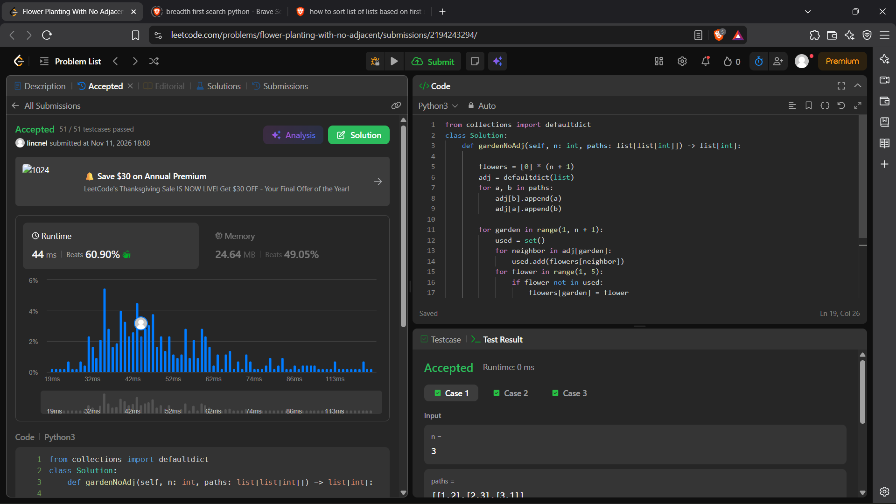
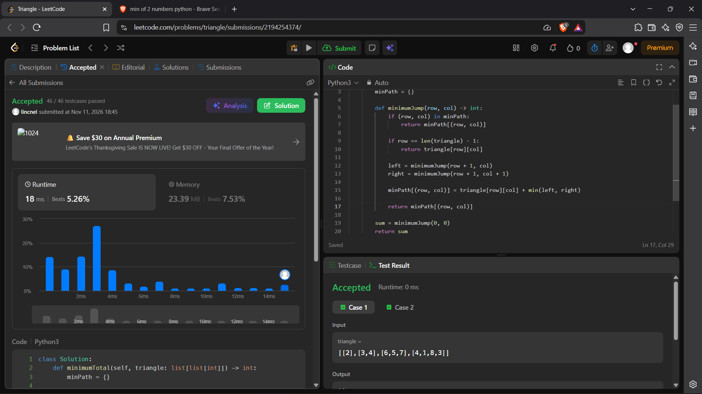
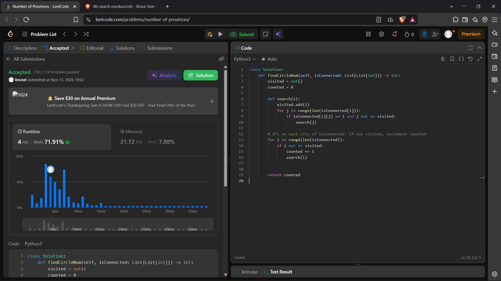

# Project Leetcode

## Problem 1 [25 points]

### Problem Information

Problem Name: *Tribonacci*

[https://leetcode.com/problems/n-th-tribonacci-number/submissions/2193500402/]()

*Insert your screenshot here, named `problem-1.png`.*


### Time Complexity

```py
class Solution:
    def tribonacci(self, n: int) -> int:
        t1 = 0                                  #O(1) initialization is constant
        t2 = 1                                  #O(1) initialization is constant
        t3 = 1                                  #O(1) initialization is constant
        if n < 2:                               #O(1) Comparison is constant
            return n                            #O(1) Return is constant
        if n == 2:                              #O(1) Comparison is constant
            return 1                            #O(1) Return is constant
        sum = 0                                 #O(1) initialization is constant
        for i in range(3, n + 1):               #O(N) runs 3 to N times
            sum = t1 + t2 + t3                  #O(1) Adding is constant
            t1 = t2                             #O(1) Assignment is constant
            t2 = t3                             #O(1) Assignment is constant
            t3 = sum                            #O(1) Assignment is constant
        return sum                              #O(1) Return is constant
```
This solution runs in **O(N)** time.

### Space Complexity

```py
class Solution:
    def tribonacci(self, n: int) -> int:
        t1 = 0                                  #O(1) initialization is constant
        t2 = 1                                  #O(1) initialization is constant
        t3 = 1                                  #O(1) initialization is constant
        if n < 2:                               
            return n                            #O(1) Return is constant
        if n == 2:                              
            return 1                            #O(1) Return is constant
        sum = 0                                 #O(1) initialization is constant
        for i in range(3, n + 1):               #O(1) only 3 variables are stored
            sum = t1 + t2 + t3                  #O(1) Assignment is constant
            t1 = t2                             #O(1) Assignment is constant
            t2 = t3                             #O(1) Assignment is constant
            t3 = sum                            #O(1) Assignment is constant
        return sum                              #O(1) Return is constant
```
This solution takes **O(1)** space.

----

## Problem 2 [25 points]

### Problem Information

Problem Name: *Combination Sum*

[Submission Link](https://leetcode.com/problems/combination-sum/submissions/2193576214/)

*Insert your screenshot here, named `problem-2.png`.*


### Time Complexity

```py 
class Solution:
    def combinationSum(self, candidates: list[int], target: int) -> list[list[int]]:    #O(N^2) Backfill is run N times and each run takes N work
        candidates.sort()                                           #O(N * logN) sorting
        solutions = []                                              #O(1) initialization is constant

        def backfill(start, curr, difference):                      #O(N^2) Backfill is run N times and each run takes N work
            if difference == 0:                                     #O(1) Comparison is constant
                solutions.append(curr[:])                           #O(1) Appending is constant
                return                                              #O(1) initialization is constant
            for i in range(start, len(candidates)):                 #O(N) Each candidate is
                if candidates[i] > difference:                      #O(1) Comparison is constant
                    continue                        
                curr.append(candidates[i])                          #O(1) Append is constant
                backfill(i, curr, difference - candidates[i])       #O(N) backfill is recursively called N times in worst case.
                curr.pop()                                          #O(1) Popping is constant

        backfill(0, [], target)                                     #O(N^2) Backfill is run N times and each run takes N work                     
        return solutions                                            #O(1) return is constant
```
This solution runs in **O(N^2)** time, due to backfill taking N time worst case scenario, and being called N times.
### Space Complexity

```py 
class Solution:
    def combinationSum(self, candidates: list[int], target: int) -> list[list[int]]:    
        candidates.sort()                                           #O(1) sorting done in place
        solutions = []                                              #O(1) initialization is constant

        def backfill(start, curr, difference):                      
            if difference == 0:                                     
                solutions.append(curr[:])                           #O(S) Appending is constant; each solution S is saved
                return                                              #O(1) initialization is constant
            for i in range(start, len(candidates)):                 
                if candidates[i] > difference:                      
                    continue                        
                curr.append(candidates[i])                          #O(1) Append is constant
                backfill(i, curr, difference - candidates[i])       #O(N) Recursively called N times in worst case.
                curr.pop()                                          #O(1) Popping is constant

        backfill(0, [], target)                                     #O(N) Backfill is run N times           
        return solutions                                            #O(1) return is constant
```
This solution takes **O(N + S)** Space in the worst case scenario, due to storing candidates in recursive calls and saving S solutions.
----

## Problem 3 [25 points]

### Problem Information

Problem Name: *Flower Planting*

[Submission Link](https://leetcode.com/problems/flower-planting-with-no-adjacent/submissions/2194243294/)



### Time Complexity

```py
from collections import defaultdict
class Solution:
    def gardenNoAdj(self, n: int, paths: list[list[int]]) -> list[int]:

        flowers = [0] * (n + 1)                     # O(N) placeholder flowers (flower color) is initialized for size n
        adj = defaultdict(list)                     # O(1) Initialization is constant.
        for a, b in paths:                          # O(N) Each element in paths is appended.
            adj[b].append(a)                        # O(1) Appending is constant.
            adj[a].append(b)                        # O(1) Appending is constant.

        for garden in range(1, n + 1):              # O(N) Run n times where n is the number of paths.
            used = set()                            # O(1) Initialization is constant.
            for neighbor in adj[garden]:            # O(E) Each neighbor is visited.
                used.add(flowers[neighbor])         # O(1) Adding is constant.
            for flower in range(1, 5):              # O(1) run max 4 times.
                if flower not in used:              # O(1) Search is constant.
                    flowers[garden] = flower        # O(1) Assignment is constant.
                    break
        return flowers[1:]                          # O(1) Return is constant.
```
This solution requires **O(N*E)** time. Each node checks each of its neighbors E to assign flower colors.

### Space Complexity

```py
from collections import defaultdict
class Solution:
    def gardenNoAdj(self, n: int, paths: list[list[int]]) -> list[int]:

        flowers = [0] * (n + 1)                     # O(N) placeholder flowers (flower color) are initialized for size n
        adj = defaultdict(list)                     # O(1) Initialization is constant.
        for a, b in paths:                          # O(N) Each element in paths is appended.
            adj[b].append(a)                        # O(1) Appending is constant.
            adj[a].append(b)                        # O(1) Appending is constant.

        for garden in range(1, n + 1):
            used = set()                            # O(1) Initialization is constant.
            for neighbor in adj[garden]:            # O(E) Each neighbor is added to used.
                used.add(flowers[neighbor])         # O(1) Adding one element is constant.
            for flower in range(1, 5):              # O(1) run max 4 times.
                if flower not in used:              # O(1) Search is constant.
                    flowers[garden] = flower        # O(1) Assignment is constant.
                    break
        return flowers[1:]                          # O(1) Return is constant.
```
Space complexity for this solution is **O(N + E)** where N is the number of paths. E is reset each garden, so worst case scenario it grows to however many neighbors a garden has. For this problem it is max four, so this could be seen as constant.
----

## Problem 4 [10 points]

### Problem Information

Problem Name: *Triangle*

[Submission Link](https://leetcode.com/problems/triangle/submissions/2194254374/)



### Time Complexity

```py
class Solution:
    def minimumTotal(self, triangle: list[list[int]]) -> int:
        minPath = {}                                                            #O(1) Initialization is constant

        def minimumJump(row, col) -> int:   
            if (row, col) in minPath:                                           #O(1) Comparison is constant
                return minPath[(row, col)]                                      #O(1) Return and lookup are constant

            if row == len(triangle) - 1:                                        #O(1) Comparison is constant
                return triangle[row][col]                                       #O(1) return and lookup are constant
            left = minimumJump(row + 1, col)                                    #O(N) Each element of the triangle is considered and called
            right = minimumJump(row + 1, col + 1)                               #O(N) Each element of the triangle is considered and called
            minPath[(row, col)] = triangle[row][col] + min(left, right)         #O(1) Assignment, addition, lookup are all constant
            return minPath[(row, col)]                                          #O(1) return and lookup are constant
        sum = minimumJump(0, 0)                                                 #O(1) assignment is constant
        return sum                                                              #O(1) Return is constant
```
Time complexity for this solution is **O(N)** because each element of the triangle is recursively called, and each call takes constant time.

### Space Complexity

```py
class Solution:
    def minimumTotal(self, triangle: list[list[int]]) -> int:
        minPath = {}                                                            #O(1) Initialization is constant

        def minimumJump(row, col) -> int:   
            if (row, col) in minPath:                                           
                return minPath[(row, col)]                                      #O(1) Return is constant

            if row == len(triangle) - 1:                                        
                return triangle[row][col]                                       #O(1) return is constant
            left = minimumJump(row + 1, col)                                    #O(N) Each element of the triangle is saved and called
            right = minimumJump(row + 1, col + 1)                               #O(N) Each element of the triangle is saved and called
            minPath[(row, col)] = triangle[row][col] + min(left, right)         #O(1) Assignment is constant
            return minPath[(row, col)]                                          #O(1) return is constant
        sum = minimumJump(0, 0)                                                 #O(1) assignment is constant
        return sum                                                              #O(1) Return is constant
```
Space complexity for this solution is **O(N)** because each element of the triangle is stored and recursively called.

----

## Problem 5 [10 points]

### Problem Information

Problem Name: *Number of provinces*

[Submission Link](https://leetcode.com/problems/number-of-provinces/)



### Time Complexity

```py
class Solution:
    def findCircleNum(self, isConnected: List[List[int]]) -> int:
        visited = set()                                             # O(1) initialization is constant.
        counted = 0                                                 # O(1) initialization is constant.
        
        def search(i):                                              # O(N*E) Run N times and also searches each neighbor E each time.
            visited.add(i)                                          # O(1) Adding is constant.
            for j in range(len(isConnected[i])):                    # O(E) Each neighbor E is searched.
                if isConnected[i][j] == 1 and j not in visited:     # O(1) Comparison and lookup are constant.
                    search(j)                                       # O(E) Each neighbor E is searched.
        for i in range(len(isConnected)):                           # O(N) Each non-visited node is checked if visited.
            if i not in visited:                                    # O(1) Lookup is constant.
                counted += 1                                        # O(1) Incrementation is constant.
                search(i)                                           # O(N) Each non visited node is searched, worst case scenario each node is searched.


        return counted                                              # O(1) Return is constant.
```
Run time for this solution is **O(N*E)**, where N is the number of nodes and E is the number of edges. DFS implementation.

### Space Complexity

```py
class Solution:
    def findCircleNum(self, isConnected: List[List[int]]) -> int:
        visited = set()                                             # O(1) initialization is constant.
        counted = 0                                                 # O(1) initialization is constant.
        
        def search(i):                                              # O(N) Visited will end up holding all nodes.
            visited.add(i)                                          # O(1) Adding is constant.
            for j in range(len(isConnected[i])):                    
                if isConnected[i][j] == 1 and j not in visited:     
                    search(j)                                       
        for i in range(len(isConnected)):                           
            if i not in visited:                                    
                counted += 1                                        # O(1) Incrementation is constant.
                search(i)                                           # O(N) Each non visited node is searched, worst case scenario each node is searched.


        return counted                                              # O(1) Return is constant.
```
Space complexity for this solution is **O(N)**, where N is the number of nodes. DFS implementation.

----

## Problem 6 [5 points]

### Problem Information

Problem Name: *Course Schedule*

[Submission Link](https://leetcode.com/problems/course-schedule/submissions/2194271699/)

[p6](problem-6.png)

### Time Complexity

```py
from collections import defaultdict


class Solution:
    def canFinish(self, numCourses: int, prerequisites: list[list[int]]) -> bool:
        connectedCourses = defaultdict(list)                            # O(1) initialization is constant
        for a, b in prerequisites:                                      # O(N) each prereq is added to dictionary
            connectedCourses[b].append(a)                               # O(1) Appending is constant
        visited = set()                                                 # O(1) initialization is constant
        inProgress = set()                                              # O(1) initialization is constant

        def search(i):                                                  # O(N*E) each node and all its edges are visited
            visited.add(i)                                              # O(1) adding is constant
            inProgress.add(i)                                           # O(1) initialization is constant
            for j in connectedCourses[i]:                               # O(E) Each edge of node is considered
                if j in inProgress:                                     # O(1) Comparison is constant
                    return False                                        # O(1) Return is constant
                if j not in visited:                                    # O(1) Comparison is constant
                    if not search(j):                                   # O(1) Comparison is constant
                        return False                                    # O(1) Return is constant
            inProgress.remove(i)                                        # O(1) Removal is constant
            return True                                                 # O(1) initialization is constant

        for i in range(numCourses):                                     # O(N) Each course is hit
            if i not in visited:                                        # O(1) Set check is constant
                if not search(i):                                       # O(1) Comparison is constant
                    return False                                        # O(1) Return is constant
        return True                                                     # O(1) initialization is constant

```
Time complexity is **O(N*E)** due to the DFS search algorithm.
### Space Complexity
```py
from collections import defaultdict


class Solution:
    def canFinish(self, numCourses: int, prerequisites: list[list[int]]) -> bool:
        connectedCourses = defaultdict(list)                        # O(1) initialization is constant
        for a, b in prerequisites:                                  # O(N) Each node is added
            connectedCourses[b].append(a)                           # O(1) Each append is constant
        visited = set()                                             # O(1) initialization is constant
        inProgress = set()                                          # O(1) initialization is constant

        def search(i):
            visited.add(i)                                          # O(N) Eventually all are visited
            inProgress.add(i)                                       # O(E) All nodes are added then removed.
            for j in connectedCourses[i]:                   
                if j in inProgress:
                    return False
                if j not in visited:
                    if not search(j):
                        return False
            inProgress.remove(i)                                    # O(1) Removal is constant
            return True

        for i in range(numCourses):
            if i not in visited:
                if not search(i):
                    return False
        return True

```
Time complexity is **O(2N * E)** due to storing courses and their prereqs.

----

## Problem 7 [5 extra credit points]

### Problem Information

Problem Name: *fill me in*

[Submission Link]()

*Insert your screenshot here, named `problem-7.png`.*

### Time Complexity

*Fill me in*

### Space Complexity

*Fill me in*

----

## Problem 8 [5 extra credit points]

### Problem Information

Problem Name: *fill me in*

[Submission Link]()

*Insert your screenshot here, named `problem-8.png`.*

### Time Complexity

*Fill me in*

### Space Complexity

*Fill me in*

----

## Problem 9 [5 extra credit points]

### Problem Information

Problem Name: *fill me in*

[Submission Link]()

*Insert your screenshot here, named `problem-9.png`.*

### Time Complexity

*Fill me in*

### Space Complexity

*Fill me in*

----

## Problem 10 [5 extra credit points]

### Problem Information

Problem Name: *fill me in*

[Submission Link]()

*Insert your screenshot here, named `problem-10.png`.*

### Time Complexity

*Fill me in*

### Space Complexity

*Fill me in*

## Project Review

*Fill me in*